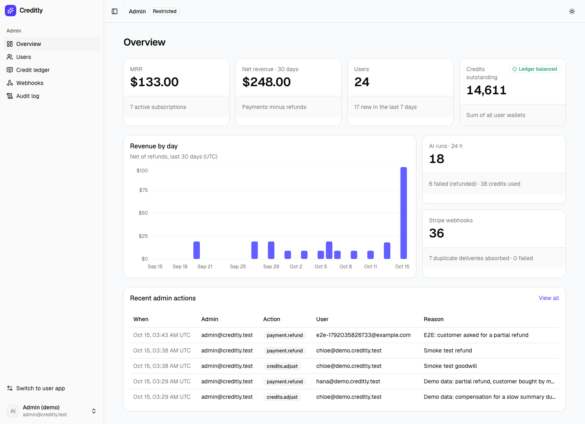

# Creditly

A credit-based AI SaaS starter: Stripe subscriptions and one-off credit packs, a
double-entry credit ledger enforced by Postgres, an AI "Summarize & extract" tool
billed per token, and an admin dashboard for revenue, refunds and audit.

> Portfolio project. Stripe runs in **test mode only** (against `stripe/stripe-mock`
> by default); seeded users are labelled **Demo data**.



## What to look at

1. **The ledger can't be wrong, even if the app code is.** Balances are the sum of
   entries (no balance column). Deferred constraint triggers reject any transaction
   that doesn't sum to zero or that takes a wallet negative, and entries are
   append-only — [`drizzle/0002_ledger_guards.sql`](drizzle/0002_ledger_guards.sql).
   Posting locks only the user wallets involved, in a fixed order, so there is no
   global hot row — [`src/lib/ledger/index.ts:70`](src/lib/ledger/index.ts).
2. **Webhooks survive duplicates and reordering.** The event id is stored first
   (repeats only bump a delivery counter), the event row is locked while it is
   applied, subscription state only moves forward in Stripe time, and events that
   arrive before what they depend on return 500 so Stripe retries —
   [`src/lib/billing/webhooks.ts:37`](src/lib/billing/webhooks.ts). The local
   simulator can deliver every checkout "flaky" (twice, out of order) through the
   real signed endpoint.
3. **Reserve → run → settle for AI usage.** Credits are held under the wallet lock
   together with the rate-limit check, the provider runs outside any transaction,
   and every job is closed exactly once: settled for actual tokens or released in
   full on any error — [`src/lib/ai/jobs.ts:28`](src/lib/ai/jobs.ts). The Anthropic
   provider uses structured outputs and server-side refusal fallbacks
   ([`src/lib/ai/anthropic.ts`](src/lib/ai/anthropic.ts)); URL fetching blocks
   private addresses ([`src/lib/ai/fetch-url.ts`](src/lib/ai/fetch-url.ts)).
4. **Admin writes are authorised in the service, not just the page.** Every
   admin operation re-reads the actor's role from the database and writes an
   append-only audit row in the same transaction. Refunds lock the payment across
   the Stripe call so a concurrent refund or the later `charge.refunded` webhook
   cannot double-book — [`src/lib/admin/service.ts:76`](src/lib/admin/service.ts).
5. **Tests run against real Postgres**, including races (parallel holds, double
   submits) and mutation-checked guards — [`tests/`](tests). The e2e journey
   covers sign-up → purchase → AI run → admin refund — [`e2e/journey.spec.ts`](e2e/journey.spec.ts).

Architecture notes and trade-offs: [`docs/ARCHITECTURE.md`](docs/ARCHITECTURE.md).

## Run it

```bash
docker compose up --build
```

| URL | |
| --- | --- |
| http://localhost:3101 | the app |
| http://localhost:8041 | Mailpit (password-reset emails) |

Log in as `admin@creditly.test` / `admin-demo-1234` (from `SEED_ADMIN_PASSWORD`),
or as a demo user, e.g. `ava@demo.creditly.test` / `demo-password`, or sign up.
In test mode, "Checkout" and "Manage billing" open a local simulator that sends
signed Stripe events to `/api/stripe/webhook`.

Without `ANTHROPIC_API_KEY` the AI runs in **demo mode** (an offline extractive
summarizer, same credit accounting). Add the key to `.env` to use Claude.

### Local development

```bash
cp .env.example .env            # then set AUTH_SECRET (openssl rand -base64 32)
docker compose up -d db stripe-mock mailpit
npm install
npm run db:migrate && npm run seed
npm run dev                      # http://localhost:3101
```

### Tests

```bash
npm test               # Vitest against Postgres (creates/migrates creditly_test)
npm run e2e            # Playwright journey against :3101
npm run screenshots    # regenerates docs/screenshots (desktop 1440 / mobile 390)
```

## Stack

Next.js 16 (App Router, server actions) · TypeScript · Tailwind CSS 4 + shadcn/ui
(CSS-variable theme, dark mode, lucide icons) · Postgres 17 + Drizzle ORM · Auth.js
v5 (email/password; Google when `AUTH_GOOGLE_ID` is set) · Stripe · Anthropic SDK ·
Vitest · Playwright.

## Pricing model

| Product | Price | Credits |
| --- | --- | --- |
| Free | $0 | 50 on sign-up |
| Pro | $19 / month | 1,000 each paid invoice (unused roll over) |
| Top-up | $9 once | 500 |

1 credit = 1,000 input tokens or 200 output tokens, rounded up per run.
